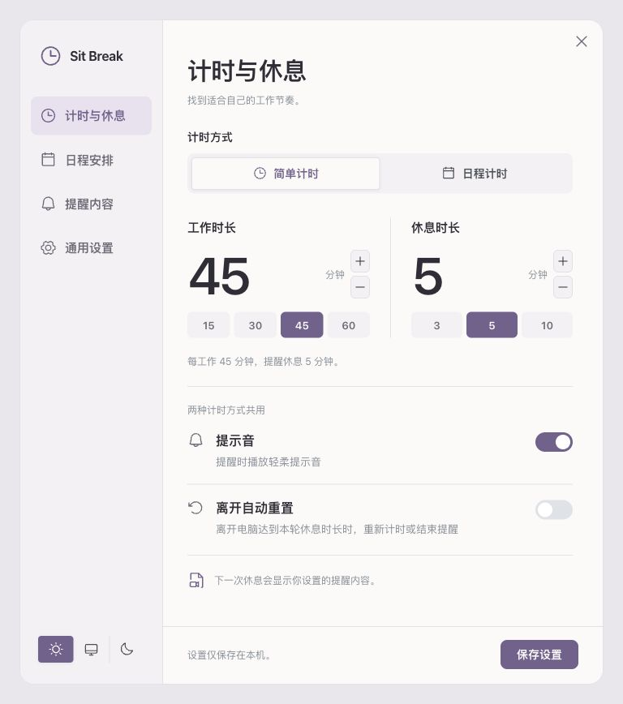
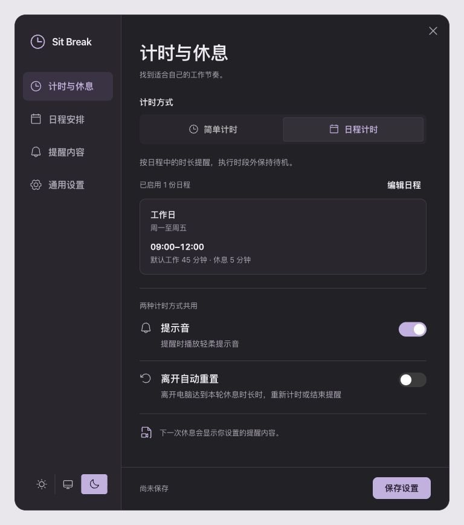
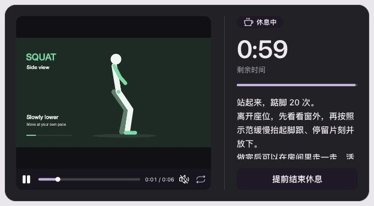

  

# Sit Break · Break Reminders

**Work at your own pace, with reminders to get up and move.** Sit Break runs locally in the macOS menu bar or Windows system tray. Use a fixed work/break rhythm or schedules organized by date and time period. During breaks, show your own text and imported local videos.

**English** | [简体中文](README.zh-CN.md)

[Download the latest release](https://github.com/yuexiaoliang/sit-break/releases/latest) · [v0.5.0 release notes](docs/releases/v0.5.0.en.md) · [Schedule guide](docs/schedules.en.md)

## What's New in v0.5.0

- **A consistent interface:** Settings, the tray panel, break reminders, and the Windows floating timer share controls and a soft plum palette, with light, dark, and system themes.
- **Clear timer modes:** Choose Simple timer or Scheduled timer at the top. Only the selected mode's settings appear. Switching preserves drafts; changes take effect when saved.
- **Local video guidance:** Import a local video for a reminder entry or an individual scheduled round. Use text, video, or both.
- **Compact break windows:** Single-line text uses a smaller window, while long text scrolls independently. Video, the countdown, and the end-break button remain visible.
- **More comfortable settings:** Sidebar navigation, schedule summaries, empty-state guidance, rounded windows, and subtle transitions that respect reduced-motion preferences.

## Interface Preview

These screenshots use sample data and the Chinese interface: light Simple timer on the left, dark Scheduled timer on the right. The app also supports an English interface.

<table>
  <tr>
    <td align="center"></td>
    <td align="center"></td>
  </tr>
</table>

  

## Download and Install

Visit the [latest release](https://github.com/yuexiaoliang/sit-break/releases/latest) and choose a file:

| Platform | File | Usage |
| --- | --- | --- |
| macOS | `Sit.Break_<version>_universal.dmg` | Supports Apple Silicon and Intel; open it and drag the app into Applications |
| Windows x64 | `Sit.Break_<version>_x64-setup.exe` | Recommended installer; can install WebView2 when needed |
| Windows x64 | `Sit.Break_<version>_x64_en-US.msi` | MSI installer |
| Windows x64 | `sit-break.exe` | Portable executable; requires WebView2 Runtime to be installed already |

**Compatibility:** macOS 12+ with a system WKWebView supporting WebKit 15.4+; install available system and browser-component updates. Windows 10/11 x64 requires a WebView2 Runtime based on Chromium 108+; keep it updated. Settings, timers, and imported videos work locally without an account. The Windows installer may need an Internet connection to install a missing WebView2 Runtime.

macOS builds use local ad-hoc signing and are not notarized by Apple. Windows installers are not code-signed.

Quit the old version before upgrading. Replacing a regular installation preserves its settings and schedules. Separate test builds, such as `Sit Break Preview` and `Sit Break UI Check`, use different data directories; their schedules do not migrate automatically to the regular release.

## Getting Started

After launching the app:

- **macOS:** Click the menu bar icon or countdown, then open Settings. The app has no Dock icon or desktop floating timer.
- **Windows:** Click the system tray icon or desktop floating timer, then open Settings. The tray icon may be inside the hidden-icons menu.

### Simple Timer

Open Work & breaks, choose Simple timer, set the work and break lengths, and save. The initial defaults are 45 minutes of work and a 5-minute break. Preset buttons provide quick choices. Work lengths must be whole minutes from 1–240; break lengths from 1–60.

When work ends, a reminder appears first. The break countdown starts only after you select Take a break. Choose Snooze if you are not ready. After the break, the next round begins. To try it quickly, set both lengths to 1 minute.

### Scheduled Timer

Choose Scheduled timer on the same page. Use Add schedule or Edit schedules to open the editor, or select Schedules in the sidebar.

1. Name the schedule and choose a one-time date or repeating weekdays.
2. Add time periods with start/end times and default work/break lengths. End times support `24:00`; split overnight periods across two days.
3. Expand Round adjustments (optional) and add only the rounds that need different lengths, break content, or local videos. An empty length inherits the period's default.
4. Select Preview schedule to review estimates, then save. Previewing does not save the draft or start a timer.

| Timer mode | Timing rules | Without an active scheduled period |
| --- | --- | --- |
| Simple timer | Repeat one set of global work/break lengths | Keep using the simple timer |
| Scheduled timer | Follow enabled schedules, their periods, defaults, and round adjustments | Stay idle; do not fall back to the simple timer |

The overview shows enabled schedules and their configuration. Each mode retains its own settings. Edit schedules and the sidebar only navigate; they do not select a timer mode. Sound, auto-reset when away, and reminder content are shared.

For example, schedule `09:00–12:00` and `13:30–18:00` on weekdays, leaving lunch unscheduled. Gaps stay quiet. At a period's end, work timers and pending reminders stop; a break already in progress can finish. See the [schedule guide](docs/schedules.en.md) for round progression, conflicts, recovery, and sleep behavior.

### Text and Local Videos

Configure reminder tips and guidance in Reminders, or assign content to a specific round in its schedule adjustments.

- Each reminder entry needs text, a video, or both.
- Import local MP4/M4V files through the system file picker. H.264-encoded MP4 is recommended. The app checks playback support; convert incompatible videos and import them again.
- The app stores a copy. Moving or deleting the original does not affect imported guidance. Reimport after editing the source. Canceling or failing an import preserves the previous choice.
- Guidance supports local video files only, without URLs, online content, HTML files, or pasted HTML source.

A round with text or video uses its complete content combination. If neither is configured, it selects a complete global reminder entry at random. Text is displayed as written and can describe multiple activities, while the entire break shares one countdown.

After you start the break, videos loop muted by default. Play/pause, seeking, and sound controls do not change the break countdown. Theme changes and countdown updates preserve playback state. Ending the break stops playback.

## Appearance and Everyday Controls

Choose Light, Dark, or System from the sidebar footer or General settings. Saving applies the appearance across windows. Changing the theme preserves drafts and video playback. System reduced-motion preferences reduce nonessential transitions.

- **Pause and reset:** Pause remains until you resume. Reset restarts the current round's work; ending a break early advances to the next round.
- **Auto-reset when away:** Uses the current break length as its threshold and can be disabled. A long enough absence during work resets that round; after a reminder, it counts as having rested.
- **Resume after quitting:** A normal exit can preserve the round and pause state when reopening in the same schedule period on the same day. Time while the app is closed does not advance timers.
- **Local preferences:** Configure launch at login, sound, and a Chinese or English interface. Windows also supports showing, hiding, and resizing the floating timer.
- **Drafts and shortcuts:** Switching sidebar pages or timer modes preserves drafts. Save with `⌘S` or `Ctrl+S`. `Esc` closes an open dropdown or dialog first.

## Development

Source setup, checks, and release procedures are documented in the [development guide](docs/development.md), maintained in Simplified Chinese.

## License

[MIT](LICENSE)
