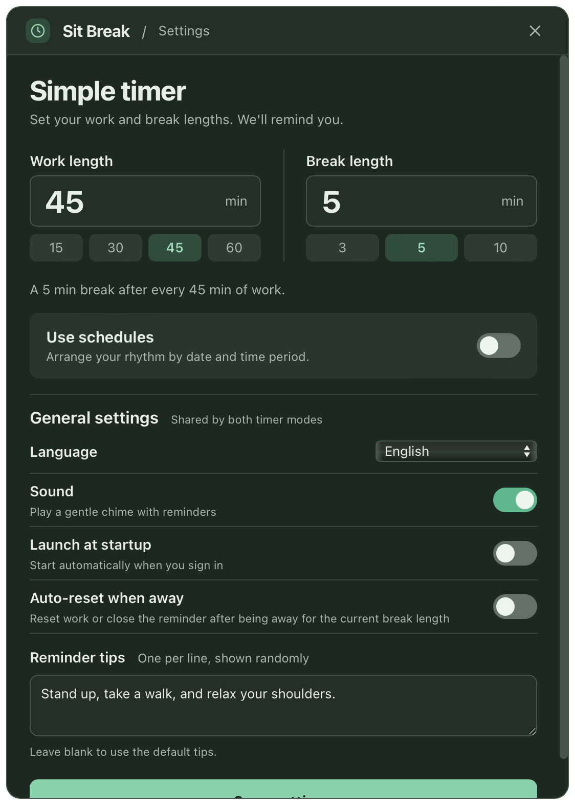
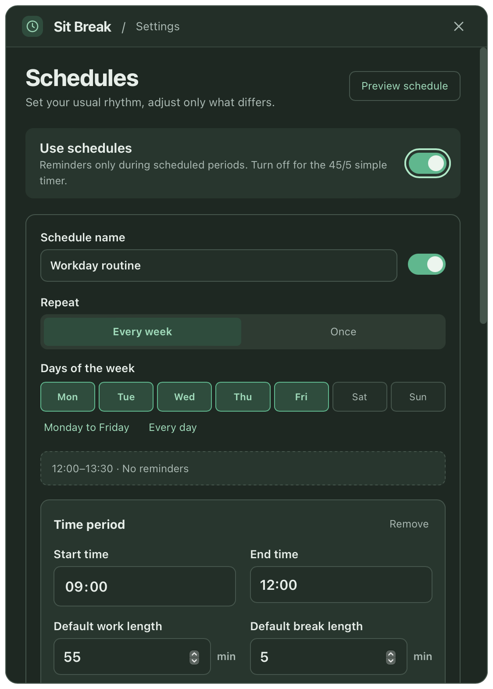
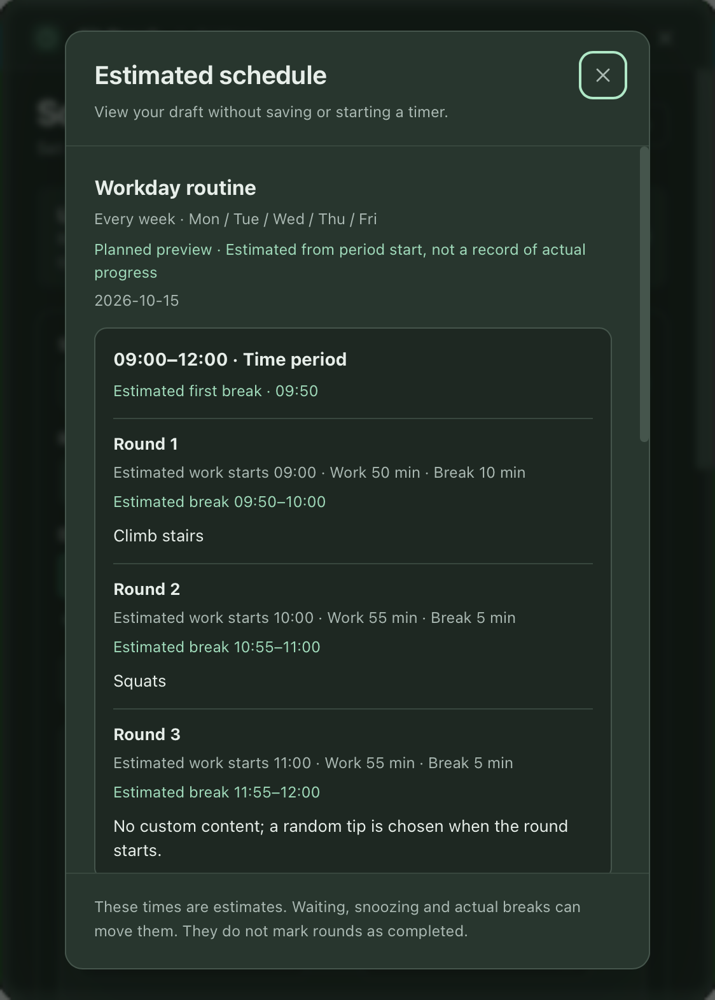

<p align="center">
  
</p>

# Sit Break · Break Reminders

[](https://github.com/yuexiaoliang/sit-break/releases/latest)
[](https://github.com/yuexiaoliang/sit-break/releases/latest)
[](https://github.com/yuexiaoliang/sit-break/releases/latest)
[](https://github.com/yuexiaoliang/sit-break/actions/workflows/ci.yml)
[](LICENSE)

**Work at your own pace, with reminders to get up and move.** Sit Break lives in the macOS menu bar or Windows system tray. By default, it repeats one set of work and break durations. When you need more detail, enable schedules to give mornings, afternoons, and individual rounds their own durations and break activities.

**English** | [简体中文](README.zh-CN.md)

[Download the latest release](https://github.com/yuexiaoliang/sit-break/releases/latest) · [Schedule guide (Chinese)](docs/schedules.md)

## Two Timer Modes

| | Simple timer | Scheduled timer |
| --- | --- | --- |
| Best for | The same rhythm every round | Different routines by time of day or round |
| Setup | Set work and break lengths | Enable “Use schedules,” add time periods, and optionally adjust individual rounds |
| Repetition | Repeat work and break cycles | Run once on a date, or repeat on selected weekdays |
| Break content | Randomly show your custom reminder tips | Assign one or more activities to a particular round |
| Outside scheduled periods | Keep using the simple timer | Stay idle; do not start new work timers or break reminders |

The simple timer is the default. Switching schedules on or off preserves the settings for the other mode and keeps the settings window the same width. Language, sound, launch at startup, and auto-reset when away are shared by both modes.

## Screenshots

These screenshots show the native macOS interface in English, using a sample schedule. macOS displays its countdown in the menu bar; Windows additionally offers a draggable, resizable floating timer.

<table>
  <tr>
    <td align="center"></td>
    <td align="center"></td>
  </tr>
  <tr>
    <td align="center">Simple timer</td>
    <td align="center">Optional schedules</td>
  </tr>
</table>

<p align="center">
  
</p>

The preview opens in a separate dialog. Viewing it does not save your draft or start a timer. Settings and previews follow your system's light or dark appearance.

## Download and Install

Visit the [latest release](https://github.com/yuexiaoliang/sit-break/releases/latest) and choose a file for your platform:

| Platform | File | Usage |
| --- | --- | --- |
| macOS | `Sit.Break_<version>_universal.dmg` | Supports Apple Silicon and Intel; open it and drag the app into Applications |
| Windows x64 | `Sit.Break_<version>_x64-setup.exe` | Recommended installer |
| Windows x64 | `Sit.Break_<version>_x64_en-US.msi` | MSI installer |
| Windows x64 | `sit-break.exe` | Portable executable; requires WebView2 Runtime to be installed already |

Requires macOS 12+, or Windows 10/11 with WebView2. macOS builds use local ad-hoc signing and are not notarized by Apple. Windows installers are not code-signed.

After installation, open settings from:

- **macOS:** Click the ring logo or countdown in the menu bar, then choose “Settings.” The app has no Dock icon or desktop floating timer.
- **Windows:** Click the system tray icon or floating timer, then choose “Settings.” You may need to expand the tray's hidden icons.

If you used **Sit Break Preview / Sit Break 测试版**, quit it before starting the regular release. Preview and regular builds store settings separately, so schedules created in the preview do not migrate automatically. Upgrading an existing regular installation preserves its settings.

## Getting Started

1. For a fixed rhythm, leave “Use schedules” off, set your work and break lengths, and click “Save settings.” The initial defaults are 45 minutes of work and a 5-minute break.
2. For detailed routines, enable “Use schedules,” choose a date or repeating weekdays, and add time periods.
3. Set each period's default work and break lengths. Expand “Round adjustments (optional)” and add only the rounds that need different settings.
4. Click “Preview schedule” to review the estimates, then save. To try a reminder quickly, start with 1 minute of work and a 1-minute break.

### A Workday Example

Repeat Monday through Friday and add two time periods, leaving a lunch gap between them:

| Time | Default rhythm | Round adjustments |
| --- | --- | --- |
| 09:00–12:00 | Work 55 minutes, break 5 minutes | Round 1: work 50 minutes, break 10 minutes, “Climb stairs”; round 2: “Squats” |
| 12:00–13:30 | Leave this gap unscheduled; no reminders | — |
| 13:30–18:00 | Work 60 minutes, break 5 minutes | Leave adjustments empty to use the defaults |

Starting at 09:00 without postponing a break gives an estimated first break at 09:50. Starting the afternoon at 13:30 means working for a full 60 minutes before the first break at 14:30.

Break content is displayed exactly as entered. It can describe one or more activities and include line breaks. The whole break shares one countdown; the app does not split the text into separate activity timers.

### Start Your Break When You Are Ready

When work ends, a reminder appears first. Choose “Snooze” or “Take a break.” Snoozing stays within the same round and does not skip that break.

For example, if a break is estimated for 09:50 but you start at 09:55, a 10-minute break lasts until 10:05, and the next round starts afterward. Preview times are estimates that move as you wait or take breaks.

At a period's end, unfinished work stops and reminders for breaks that have not started close. A break already in progress can finish. Lunch gaps do not catch up on missed rounds or start new reminders.

## 动作指引（开发分支）

视频、网页动作指引与 HTML 制作材料正在 [PR #26](https://github.com/yuexiaoliang/sit-break/pull/26) 集成验收，尚未包含在 v0.4.0 正式版中。开发分支支持按提醒条目或日程单轮选择内置示范、导入本地视频与单文件 HTML、配置在线地址，并提供失败重试、当前轮保留和进度恢复。

使用方式见 [动作指引说明](README.zh-CN.md#动作指引开发分支)、[HTML 制作说明](docs/html-authoring.md)与[原生验收记录](docs/native-webview-check.md)。

## More Features

- **Pause and reset:** A manual pause lasts until you resume. Reset restarts work in the current round; ending a break early advances to the next round.
- **Schedule progress recovery:** After a normal quit, reopening on the same day within the same valid period can restore the current round and pause state. Time while the app is closed does not count down.
- **Auto-reset when away:** Uses the current round's break length to decide whether you have been away long enough. You can turn it off. Sleep is handled according to the current phase and does not count as work.
- **Custom tips and sound:** Maintain your own tips, avoid consecutive repeats when different options exist, and turn reminder sounds on or off.
- **Launch at startup:** Choose whether the app runs automatically when you sign in.
- **Chinese / English interface:** Follow your system language or select one manually.

For editing running schedules, conflicts, reopening, and sleep rules, see the [schedule guide (Chinese)](docs/schedules.md). Check coverage and acceptance records are documented in [verification notes (Chinese)](docs/schedule-verification.md).

## Run and Build from Source

Install [Node.js 22.12+](https://nodejs.org) and [Rust](https://rustup.rs). On macOS, install Xcode Command Line Tools (`xcode-select --install`). On Windows, install the MSVC build tools and WebView2.

```bash
npm ci
npm run tauri dev    # Development mode
npm run tauri build  # Build the app and installers
```

After installing Rust, reopen your terminal or run `source "$HOME/.cargo/env"`. Bundles are written to `src-tauri/target/release/bundle/`; the portable Windows executable is `src-tauri/target/release/sit-break.exe`.

To build an app for your local Mac only:

```bash
npm run tauri build -- --bundles app
```

To build a universal macOS app for Apple Silicon and Intel:

```bash
rustup target add aarch64-apple-darwin x86_64-apple-darwin
npm run tauri build -- --target universal-apple-darwin
```

The project uses **Tauri 2, Rust, TypeScript, and Vite**, with HTML / CSS for the interface. Rust manages timers, progress, windows, and power events. Closing settings or a panel does not interrupt the timer.

## Checks and Releases

- [CI](.github/workflows/ci.yml): Frontend checks and builds, Rust checks, formatting, tests, and application binary builds on macOS and Windows.
- [Windows preview](.github/workflows/windows-preview.yml): Builds x64 installers and portable executables for PRs with separate preview settings. See the [preview guide (Chinese)](docs/windows-preview.md) for downloads.
- [Release](.github/workflows/release.yml): Pushing a `v*` tag builds and publishes the universal macOS DMG, Windows NSIS / MSI installers, and portable executable.

Keep features, examples, and installation instructions in sync across both full READMEs, and use interface screenshots in each README's language. Before releasing, update both READMEs and release notes, and complete checks and acceptance testing. From an up-to-date `main` branch with a clean working tree, run:

```bash
npm run release -- minor --dry-run  # Preview without changing files or pushing
npm run release -- minor            # Also accepts patch, major, or an explicit version
```

The release script synchronizes npm, Tauri, and Rust versions and lockfiles, then commits, creates a tag, and pushes. Regenerate icons with `npm run icons`; source assets are described in the [logo design notes (Chinese)](docs/design/logo-brief.md).

## License

[MIT](LICENSE)
