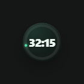
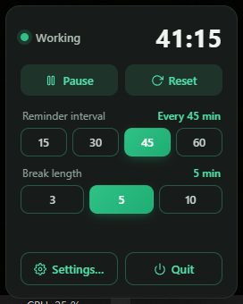
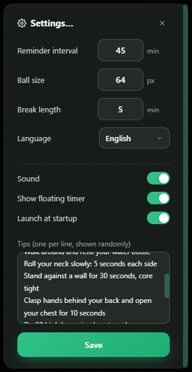
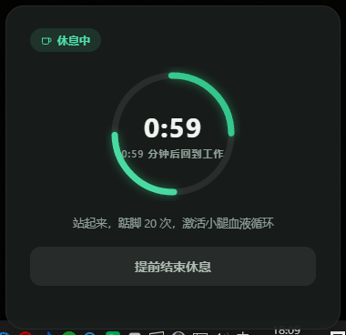

<p align="center">
  
</p>

# Sit Break · 久坐提醒

[](https://github.com/yuexiaoliang/sit-break)
[](https://github.com/yuexiaoliang/sit-break)
[](https://tauri.app)
[](https://www.rust-lang.org)
[](LICENSE)
[](../../releases)
[](../../actions/workflows/ci.yml)

**小巧、美观、好用的 macOS / Windows 久坐提醒工具。** Sit Break 常驻 macOS 菜单栏或 Windows 系统托盘安静倒计时，到点弹出提醒让你起来活动。优先在 MacBook 上开发和验证，同时保留 Windows 支持。

[English](README.md) | 简体中文

<!-- 关键词：久坐提醒、坐姿提醒、休息提醒、悬浮倒计时、系统托盘、Windows 11、Tauri、Rust -->

## 截图

以下截图来自 Windows；macOS 在顶部菜单栏显示倒计时，不显示桌面悬浮球，面板和提醒使用相同界面。

<p align="center">
  
</p>

<table>
  <tr>
    <td align="center"></td>
    <td align="center"></td>
  </tr>
  <tr>
    <td align="center">托盘面板</td>
    <td align="center">设置</td>
  </tr>
  <tr>
    <td align="center"></td>
    <td align="center"></td>
  </tr>
  <tr>
    <td align="center">久坐提醒</td>
    <td align="center">休息倒计时</td>
  </tr>
</table>

## 为什么选 Sit Break

- **简洁**：计时由 Rust 后台管理，关闭面板不会中断计时；窗口隐藏后复用
- **清晰**：macOS 菜单栏实时读秒；Windows 提供毛玻璃悬浮球和渐变进度圆环
- **聪明**：系统级空闲检测——离开接杯水，计时自动重置，离开的时间不算久坐
- **双语**：中文 / English 界面，跟随系统语言，也可手动切换

## 功能

| | |
|---|---|
| ⏱ macOS 菜单栏倒计时 | 顶部实时显示 `45:00`；暂停时显示 `⏸ 45:00`，休息时显示 `休息 05:00`；点击打开面板 |
| ⏱ Windows 悬浮倒计时球 | 常驻置顶、可拖动、滚轮调大小（40–140px）、位置自动记忆 |
| 🔔 久坐提醒弹窗 | 右下角毛玻璃卡片，随机活动小建议，可"再等等" |
| 🧘 休息倒计时 | 圆环进度，休息结束自动恢复工作计时 |
| ↻ 一键重置 | 菜单栏 / 托盘面板随时重置计时 |
| 💤 空闲检测 | 无键鼠输入达到休息时长自动重置计时，可开关 |
| 🚀 开机自启 | 设置里一键开关 |
| 🔔 提示音 | 提醒弹出时轻响两声（可关） |
| ✏️ 自定义提醒小字 | 每次提醒随机展示一条；有多条不同文案时避免连续重复，支持自定义列表 |
| 🌐 中文 / English | 跟随系统语言，或手动选择 |

## 下载

前往 [Releases](../../releases) 获取最新版本：

- `Sit Break_x.y.z_universal.dmg` — macOS 通用安装包，兼容 Apple Silicon 和 Intel；打开后拖入 Applications
- `Sit Break_x.y.z_x64-setup.exe` — NSIS 安装包
- `Sit Break_x.y.z_x64_en-US.msi` — MSI 安装包
- `sit-break.exe` — 绿色便携版，免安装

> macOS 需要 12 Monterey 或更新版本；Windows 需要 10/11 + WebView2。

## 从源码构建

前置条件：[Node.js 22.12+](https://nodejs.org)、[Rust](https://rustup.rs)。macOS 安装 Xcode Command Line Tools（`xcode-select --install`）；Windows 安装 [MSVC 构建工具](https://visualstudio.microsoft.com/visual-cpp-build-tools/) 与 WebView2。

新安装 Rust 后重新打开终端，或执行 `source "$HOME/.cargo/env"`。

```bash
npm ci
npm run tauri dev    # 开发调试
npm run tauri build  # macOS 输出 .app / .dmg；Windows 输出 exe / 安装包
```

产物位于 `src-tauri/target/release/bundle/`。macOS 仅构建本机可运行的应用可使用 `npm run tauri build -- --bundles app`。发布通用版本：

```bash
rustup target add aarch64-apple-darwin x86_64-apple-darwin
npm run tauri build -- --target universal-apple-darwin
```

macOS 菜单栏应用不显示 Dock 图标或桌面悬浮球；圆环标志旁的倒计时每秒更新，等宽数字避免菜单栏跳动。点击标志或倒计时打开面板，点击面板外自动收起。Mac 设置页不提供悬浮球开关和大小选项。提醒窗口可在多个桌面显示。空闲检测使用 CoreGraphics 的会话空闲时间查询；Windows 使用 `GetLastInputInfo`。

透明窗口通过 macOS private API 实现，当前发布方式是 `.app` / `.dmg`，默认使用本地 ad-hoc 签名。对外分发时可按 [Tauri macOS 签名说明](https://tauri.app/distribute/sign/macos/)配置 Developer ID 签名和公证；当前流水线没有配置 Developer ID 凭据。

## 工作原理

```
工作计时 ──到点──▶ 提醒弹窗 ──开始休息──▶ 休息倒计时 ──结束──▶ 新一轮计时
   ▲                                                        │
   └──────────── 随时重置（菜单栏 / 托盘面板）◀──────────────┘
```

- 计时器、菜单栏 / 托盘、空闲检测、窗口管理全部在 **Rust 端**，计时不依赖前端窗口是否显示
- macOS 创建面板、设置和提醒三个 WebView 窗口；Windows 另创建悬浮球窗口，之后按状态显示或隐藏

## 技术栈

[Tauri 2](https://tauri.app) · Rust · TypeScript · Vite —— 无 UI 框架，手写 CSS。

## CI 与发布

运行 `npm run icons` 重新生成当前桌面图标；源文件与设计说明见 [LOGO 设计](docs/design/logo-brief.md)。

- **CI**（`.github/workflows/ci.yml`）：macOS / Windows 上执行前端类型检查与构建、`cargo check`、`cargo clippy`、Rust 测试
- **Release**（`.github/workflows/release.yml`）：推送 `v*` 标签自动构建 macOS 通用 DMG、Windows NSIS / MSI 安装包与便携版 exe

发布新版本只需一条命令（自动同步三处版本号、更新 Cargo.lock、commit + tag + push）：

```bash
npm run release -- patch   # 或 minor / major / 指定版本号如 1.2.3
# 先试跑不改文件：npm run release -- patch --dry-run
```

## 许可证

[MIT](LICENSE)
