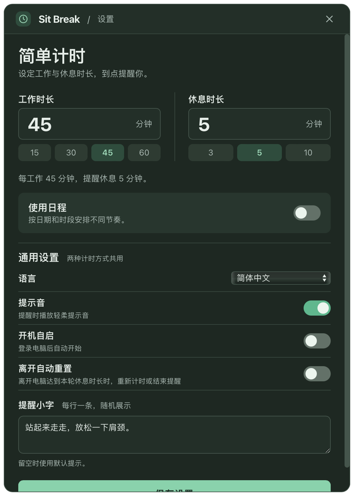
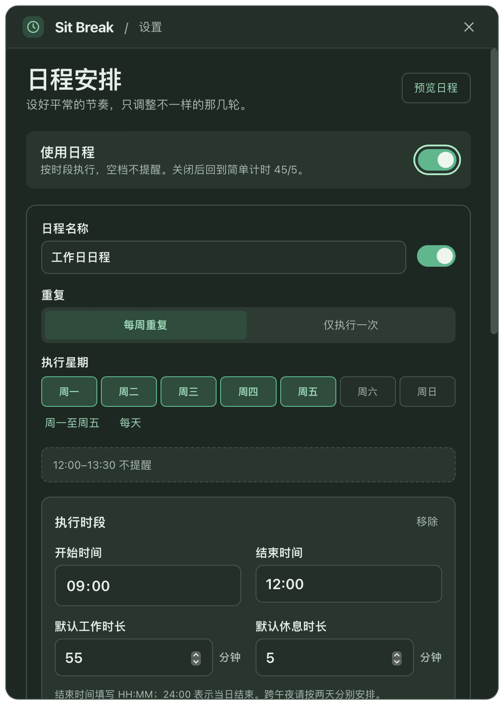

<p align="center">
  
</p>

# Sit Break · 久坐提醒

[](https://github.com/yuexiaoliang/sit-break/releases/latest)
[](https://github.com/yuexiaoliang/sit-break/releases/latest)
[](https://github.com/yuexiaoliang/sit-break/releases/latest)
[](https://github.com/yuexiaoliang/sit-break/actions/workflows/ci.yml)
[](LICENSE)

**按自己的节奏工作，到点提醒你起来活动。** Sit Break 常驻 macOS 菜单栏或 Windows 系统托盘，默认用一组工作和休息时长循环计时。需要更详细的安排时，可以开启日程，为上午、下午和不同轮次设置各自的时长与休息内容。

[English](README.md) | **简体中文**

[下载最新正式版](https://github.com/yuexiaoliang/sit-break/releases/latest) · [日程使用说明](docs/schedules.md)

## 两种计时方式

| | 简单计时 | 日程计时 |
| --- | --- | --- |
| 适合 | 每轮使用相同节奏 | 上午、下午或不同轮次需要不同安排 |
| 设置方式 | 填写工作时长和休息时长 | 开启“使用日程”，添加执行时段与可选的单轮调整 |
| 重复方式 | 工作与休息持续循环 | 指定日期执行一次，或勾选星期每周重复 |
| 休息内容 | 随机展示自定义提醒小字 | 可为指定轮次填写一项或多项活动 |
| 时段之外 | 继续简单计时 | 保持待机，不启动新的工作或休息提醒 |

默认使用简单计时。开启或关闭日程不会清空另一种方式的配置，设置窗口也保持原有宽度。语言、提示音、开机自启和离开自动重置等通用设置继续共用。

## 界面预览

以下是 macOS 原生界面，使用示例日程。macOS 在顶部菜单栏显示倒计时；Windows 另有可拖动、可调大小的桌面悬浮计时条。

<table>
  <tr>
    <td align="center"></td>
    <td align="center"></td>
  </tr>
  <tr>
    <td align="center">简单计时</td>
    <td align="center">按需开启日程</td>
  </tr>
</table>

<p align="center">
  
</p>

预览放在独立浮窗中，查看不会保存草稿或启动计时。设置和预览跟随系统深色、浅色外观。

## 下载与安装

前往 [最新正式版](https://github.com/yuexiaoliang/sit-break/releases/latest)，按平台选择文件：

| 平台 | 文件 | 使用方式 |
| --- | --- | --- |
| macOS | `Sit.Break_<版本>_universal.dmg` | 支持 Apple Silicon 和 Intel；打开后把应用拖入 Applications |
| Windows x64 | `Sit.Break_<版本>_x64-setup.exe` | 推荐的安装程序 |
| Windows x64 | `Sit.Break_<版本>_x64_en-US.msi` | MSI 安装程序 |
| Windows x64 | `sit-break.exe` | 免安装程序，需要电脑已有 WebView2 Runtime |

系统要求为 macOS 12+，或 Windows 10/11 与 WebView2。macOS 使用本地 ad-hoc 签名，尚未进行 Apple 公证；Windows 安装包未使用代码签名证书。

安装后从以下入口打开设置：

- **macOS**：点击顶部菜单栏的圆环标志或倒计时，再点“设置”。应用不显示 Dock 图标或桌面悬浮计时条。
- **Windows**：点击右下角系统托盘图标或悬浮计时条，再点“设置”；托盘图标可能收在展开箭头中。

如果之前使用过 **Sit Break Preview / Sit Break 测试版**，先退出测试版再启动正式版。两者的配置独立，测试版中创建的日程不会自动迁移；升级原正式版会保留原有设置。

## 开始使用

1. 只需要固定节奏时，保持“使用日程”关闭，设置工作和休息时长，点击“保存设置”。首次使用默认为工作 45 分钟、休息 5 分钟。
2. 需要详细安排时，开启“使用日程”，为日程选择日期或重复星期，再添加执行时段。
3. 每个时段设置默认工作、休息时长；展开“单轮调整（可选）”，只填写需要不同的轮次。
4. 点击“预览日程”检查预计安排，确认后保存。想快速体验提醒，可先使用工作 1 分钟、休息 1 分钟。

### 一个工作日示例

选择每周一至周五重复，添加以下两个执行时段，中间自然留出午休空档：

| 时间 | 默认安排 | 单轮调整 |
| --- | --- | --- |
| 09:00–12:00 | 工作 55 分钟，休息 5 分钟 | 第 1 轮改为工作 50 分钟、休息 10 分钟，内容为“爬楼”；第 2 轮内容为“深蹲” |
| 12:00–13:30 | 不配置执行时段，不提醒 | — |
| 13:30–18:00 | 工作 60 分钟，休息 5 分钟 | 可留空，沿用默认时长 |

如果从 09:00 开始且没有推迟，上午首次休息预计为 09:50；下午从 13:30 开始工作满 60 分钟，首次休息预计为 14:30。

休息内容按原文展示，可以写一项或多项，也可以换行。整次休息共用一个总倒计时，应用不会把文字拆成多个活动计时器。

### 到点后，准备好再休息

工作结束先弹出提醒，你可以选择“再等等”，或点击“开始休息”。“再等等”仍属于同一轮，不会跳过本次休息。

例如预计 09:50 休息，你到 09:55 才开始：本轮 10 分钟休息会持续到 10:05，下一轮随后开始。预览中的时间是预计值，会随等待和实际休息更新。

执行时段结束时停止尚在进行的工作、收起尚未开始的休息提醒；已经开始的休息可以完成。午休等空档不补做之前的轮次，也不启动新的提醒。

## 其他功能

- **暂停与重置**：暂停保持到手动恢复；重置重新计当前轮工作，提前结束休息则进入下一轮。
- **日程进度恢复**：正常退出后，在同一天、同一有效时段重新打开可恢复本轮进度和暂停状态，应用关闭期间不累计计时。
- **离开自动重置**：按本轮休息时长判断是否离开够久，可在设置中关闭；电脑睡眠按当前阶段衔接，不把睡眠时间算成工作。
- **提醒小字与提示音**：可自定义多条文字，有不同选项时避免连续重复；提示音可关闭。
- **开机自启**：在设置中选择是否登录电脑后自动运行。
- **中文 / English 界面**：跟随系统语言，也可手动选择。

运行中修改安排、时段冲突、退出重开和睡眠的详细规则见[日程使用说明](docs/schedules.md)。检查范围和验收记录见[日程验证记录](docs/schedule-verification.md)。

## 从源码运行与构建

需要 [Node.js 22.12+](https://nodejs.org) 和 [Rust](https://rustup.rs)。macOS 安装 Xcode Command Line Tools（`xcode-select --install`）；Windows 安装 MSVC 构建工具与 WebView2。

```bash
npm ci
npm run tauri dev    # 开发调试
npm run tauri build  # 构建应用和安装包
```

安装 Rust 后需重新打开终端，或执行 `source "$HOME/.cargo/env"`。安装包位于 `src-tauri/target/release/bundle/`，Windows 免安装程序位于 `src-tauri/target/release/sit-break.exe`。

macOS 只构建本机应用：

```bash
npm run tauri build -- --bundles app
```

macOS 构建 Apple Silicon / Intel 通用版本：

```bash
rustup target add aarch64-apple-darwin x86_64-apple-darwin
npm run tauri build -- --target universal-apple-darwin
```

项目使用 **Tauri 2、Rust、TypeScript 和 Vite**，界面使用 HTML / CSS。Rust 后台负责计时、进度、窗口和电源事件，关闭设置或面板不会中断计时。

## 开发验证与发布

- [CI](.github/workflows/ci.yml)：在 macOS 和 Windows 上执行前端检查与构建、Rust 检查、格式检查、测试和应用二进制构建。
- [Windows 测试版](.github/workflows/windows-preview.yml)：为 PR 生成独立配置的 x64 安装包和免安装程序，下载方式见[测试版说明](docs/windows-preview.md)。
- [Release](.github/workflows/release.yml)：推送 `v*` 标签后构建并发布 macOS 通用 DMG、Windows NSIS / MSI 和免安装程序。

维护时同步更新完整的中英文 README，保持功能、使用示例、安装说明与截图一致。发布前更新两份 README 与发布说明，确认检查和验收完成。在已同步且工作区干净的 `main` 分支执行：

```bash
npm run release -- minor --dry-run  # 试跑，不修改文件或推送
npm run release -- minor            # 也支持 patch、major 或明确版本号
```

发布脚本会同步 npm、Tauri 和 Rust 的版本号及锁文件，再提交、创建标签并推送。图标可用 `npm run icons` 重新生成，源文件见 [LOGO 设计](docs/design/logo-brief.md)。

## 许可证

[MIT](LICENSE)
