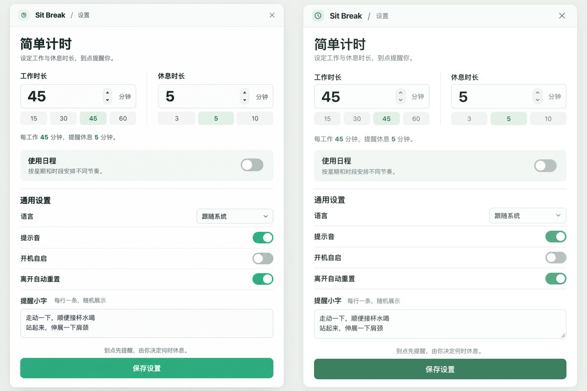

# UI 设计检查

日期：2026-10-14。对象：A · 时段卡片、「节奏优先」视觉、明暗主题及切换日程时的固定窗口宽度。

当前无待处理的 P0、P1 或 P2。只保留 A；两种主题的简单设置、日程编辑及运行状态已在真实浏览器中检查。日程向下展开是此次固定宽度要求带来的明确调整。

## 对照依据

- source visual truth path：`docs/ui-design/selected-reference.png`。
- implementation screenshot path：`docs/ui-design/evidence/simple-light.png`。
- 源图像素 1086 × 1448，以 `600 / 1086` 等比归一化为 600 × 800，不改变比例。
- 实现 CSS 视口 600 × 800，截图 600 × 800，显式视口覆盖时 `devicePixelRatio = 1`。
- 状态：浅色、macOS、简单计时 45/5、日程关闭、声音开启、自启关闭、离开自动重置开启，语言跟随系统，提醒小字与源图一致。
- 设置窗口实测 562 × 785 CSS px；演示工具位于窗口之外。浏览器为 Codex In-app Browser，页面由 Vite 渲染。
- 深色为用户要求的派生主题，沿用相同布局。没有独立深色源图，不将它表述为对深色源图的逐像素复制。
- 截图接口存在压缩和平台抗锯齿差异，统一保存为 PNG；重新编码不代表提高原始截图质量。

整屏比较证据为 `reference-comparison.png`，1200 × 800。局部比较使用双方相同区域：`comparison-timing.png` 对应 `(25,70)–(575,300)`，`comparison-preferences.png` 对应 `(25,300)–(575,710)`。已在同一比较输入中查看整屏与表单局部，没有以分别查看图片代替对照。

## 五项保真检查

| 项目 | 观察与结论 |
| --- | --- |
| 字体与排印 | 系统无衬线，标题 27/36、时长 30、标签 14、正文 13；字重、换行和层级与浅色源图一致。字体笔画和抗锯齿差异属于平台差异。深色不更改字号或行高。 |
| 间距与布局 | 简单窗口保持 562 × 785，内侧左右 22、双列间距 44、时长字段高 50、保存按钮高 42。日程和试运行也使用同一最大宽度，概览位于编辑区之后，避免切换时变宽。 |
| 颜色与视觉变量 | 浅色维持白底、灰绿分组；深色按语义配置窗口、输入、选中、提醒、休息、暂停、错误和状态反馈。浅色按钮对比度约 4.78:1；深色按钮 8.42:1、辅助文字 7.43:1、暂停正文 8.91:1、错误正文 7.45:1。主按钮比源图更深是已记录的可读性调整。 |
| 图标与图片 | Tabler 官方图标维持比例和清晰度，随文字颜色适配主题；原图无照片或插画。截图轻度压缩和系统图标的描边细微差异为预期差异。 |
| 文案与内容 | 简单模式完整保留原设置；日程沿用已确认术语、自由活动文本和推迟行为。只保留 A，产品界面不再出现方案选择或数据调试入口。 |

## 问题与修正记录

| 问题 | 修正 | 复查证据 |
| --- | --- | --- |
| P2：原型强制浅色，系统深色下仍是亮底 | 统一主题变量，默认跟随系统；原型外侧可预览明暗；原生表单同步 `color-scheme` | `simple-dark.png`、`schedule-dark.png`、深色运行状态，以及 `verification.json` 中的系统主题变化 |
| P2：日程开关将窗口从 562 扩到 960 | 所有页面统一最大宽度 562；日程单栏向下展开，根页面保留滚动空间 | 下方四种视口测量；两种主题全部通过 |
| 清理：其他方案和重复样式仍留在工作目录 | 删除 B/C、切换脚本和调试面板；样式合并为一份，清理过期截图 | 源码检索及构建检查 |

早期设计检查还修正过图标包导入路径、纵向间距、浅色按钮对比度、暂停文字颜色和编辑时重建表单的问题；历史记录与截图保存在提交 `b1831ae06e6dafe31b95c45eed47a306775a1737` 的 [检查报告](https://github.com/yuexiaoliang/sit-break/blob/b1831ae06e6dafe31b95c45eed47a306775a1737/design-qa.md)。当前目录只保留现行证据。此次同状态对照未新增需修复的 P0/P1/P2。

## 固定宽度验证

在浅色和深色下分别执行「日程开启 → 关闭 → 再开启」，实测如下。两种主题结果相同，水平位置未移动，无横向溢出。

| 浏览器宽度 | 开启日程时窗口宽度 | 关闭日程时窗口宽度 | 两种状态的左侧位置 |
| --- | --- | --- | --- |
| 1280 | 562 | 562 | 359 |
| 600 | 562 | 562 | 19 |
| 375 | 359 | 359 | 8 |
| 320 | 304 | 304 | 8 |

单位均为 CSS px。原始读数、草稿检查及控制台结果见 [verification.json](docs/ui-design/evidence/verification.json)。

## 交互与状态验证

| 场景 | 实测结果 |
| --- | --- |
| 系统外观变化 | 在浏览器模拟浅色再模拟深色，无刷新即可更新；50 分钟工作草稿和两行提醒小字保留。结束后已清除媒体模拟。 |
| 日程与外观切换 | 各视口、各主题下简单工作 50 分钟保留；再次开启日程时，第一轮的两行活动与展开状态保留。 |
| 多项活动 | 「爬楼 8 分钟」「拉伸 2 分钟」按两行展示，整次休息仍计 10 分钟。 |
| 再等等 | 09:50 提醒后推迟 5 分钟，09:55 开始休息，剩余 10:00，预计 10:05 进入第二轮。 |
| 暂停与主题 | 休息暂停后切换浅色和深色，再推进 5 分钟，剩余保持 10:00，活动内容及暂停状态不变。 |
| 待机 | 午休显示「现在不提醒」，下一时段为 13:30 下午第一轮。 |
| 冲突 | 上午结束改为 14:00 后保存被阻止，深色红框指出与下午重叠，草稿可继续修改。 |
| 空日程 | 删除两段后显示添加时段的空状态，主题一致。 |
| Windows 窄窗 | 320 px 下包含悬浮计时条开关和大小，控件可见、无横向溢出；预览工具自然换行。 |
| 焦点 | 输入内容时不重建控件；深色输入框焦点环可辨认，按钮保留键盘焦点样式。 |

证据位于 `docs/ui-design/evidence/`：简单设置为 600 × 800，日程按真实内容保存全页截图，运行状态为 600 × 900；窄屏截图为 320 CSS px 宽。没有压缩长页面来模拟一个屏幕。

## 构建与检查范围

- `npm run build` 通过 TypeScript 和 Vite 构建。
- 控制台错误与警告为空。
- 生产产物不包含原型 UI；只在开发入口按参数加载。
- 源码中只保留已确认的时段卡片，旧链接参数仅用于清理 URL。
- 中文说明与当前截图已同步；过期布局、重复样式和旧截图从当前分支目录移除。
- 原生 Tauri 主题变化、正式窗口尺寸、真实空闲/休眠、自启、声音和持久化尚未接入，仍需正式实现后的实机验证。

## 后续细化与完成检查

P3：正式接入时根据 Windows 原生字体、时间输入控件及可用屏幕区域微调，但应继续保持日程开关前后的宽度一致。

已完成：源图与实现对照、明暗主题、运行状态、系统主题变化、草稿与进度保留、固定宽度与窄屏、版本清理、构建和控制台检查、中文文档同步。

final result: passed
