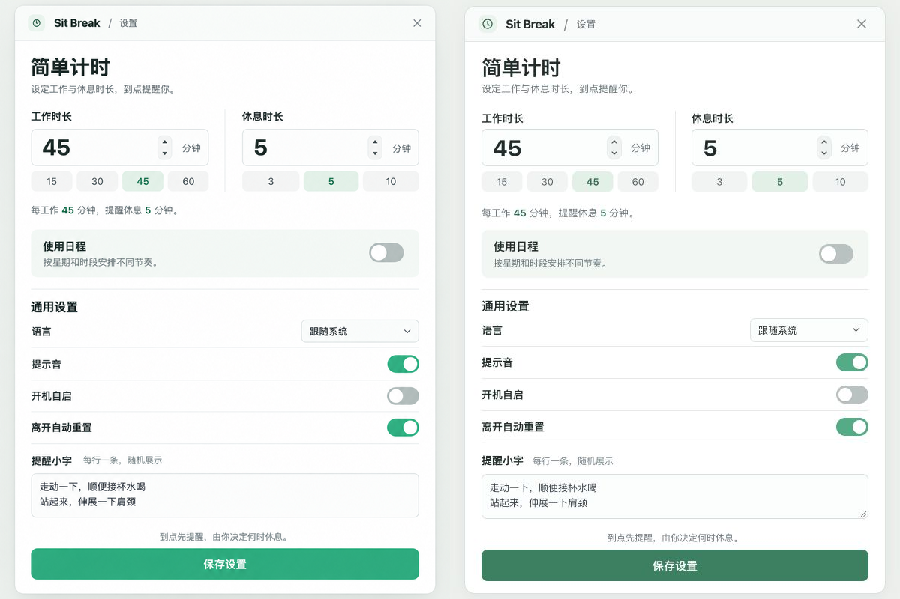
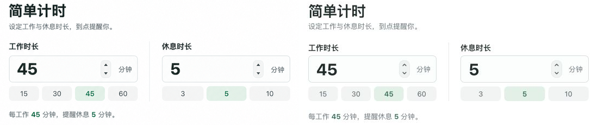
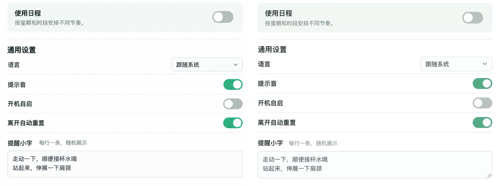

# UI 设计检查

日期：2026-10-14。对象：用户选中的第 2 张「节奏优先」及其在 A · 时段卡片中的应用。

当前没有待处理的 P0、P1 或 P2。默认简单计时完成同视口、同状态的整屏和局部对照；其余页面按同一视觉约定检查布局、操作与可读性。本报告不是正式计时引擎或系统集成验收。

## 对照依据

- source visual truth path：`docs/ui-design/selected-reference.png`。
- implementation screenshot path：`docs/ui-design/evidence/simple-final.png`。
- 源图像素：1086 × 1448；其目标 CSS 视口视作 600 × 800，以 `600 / 1086` 等比归一化，未拉伸比例。
- 实现 CSS 视口：600 × 800，浏览器显式视口覆盖时 `devicePixelRatio = 1`；实现截图 600 × 800。
- 状态：简单计时，工作 45、休息 5，使用日程关闭，提示音开启、自启关闭、离开自动重置开启，语言跟随系统，macOS 预览。提醒小字与源图一致。
- 实际窗口：562 × 785 CSS px；外侧演示工具不在源图所覆盖的产品窗口内。
- 浏览器：Codex In-app Browser，真实 Vite 页面，不是从 HTML 静态拼图。
- 截图接口输出存在轻度压缩和平台抗锯齿差异；文件统一为 PNG 保存，不以重新编码冒充更高质量。没有用 CSS 放大 UI 来补偿像素密度。

以下对照图均为左侧原始设计等比归一化、右侧实际浏览器截图，已放入同一比较输入并查看。

- 全屏证据：`docs/ui-design/evidence/comparison-final.png`，1200 × 800。
- 时长/字体局部：`docs/ui-design/evidence/comparison-timing.png`，1100 × 230；双方相同裁剪 `(25,70)–(575,300)`。
- 开关/表单局部：`docs/ui-design/evidence/comparison-preferences.png`，1100 × 410；双方相同裁剪 `(25,300)–(575,710)`。

## 五项保真检查

| 项目 | 观察与结论 |
| --- | --- |
| 字体与排印 | 系统无衬线匹配源图风格。标题 27/36、时长 30、标签 14、正文 13；字重分别约 750、700、600 和 400。标题、时间值、辅助文字层级与换行保持一致。系统中文字体的笔画和抗锯齿不能与生成图逐像素相同，归为预期平台差异；没有因此改变主要区域密度。 |
| 间距与布局节奏 | 窗口 562 × 785，页内左右 22，双列间距 44，时长字段 50 高，快捷值 27 高，日程入口 64 高，主按钮 42 高。保存按钮完整落在目标窗口内；纵向间距已由初版修正，当前边界和分组与源图对应。 |
| 颜色与视觉变量 | 白色内容、浅灰绿背景、薄边框和浅绿分组保持一致。主按钮有意改为 `#18825f` 纯色，使白字对比度约 4.78:1；正文辅助色 `#66757a` 在白底约 4.78:1，暂停辅助文字约 4.54:1。生成图中的轻微光泽没有做成界面纹理。 |
| 图片与图标 | 原图没有需重绘的照片或插画。时钟、关闭、箭头使用 Tabler 官方图标资源，清晰、比例一致；图标的细微描边形状是图标库匹配差异。没有用手绘图形、字符或占位图替代可见资产。 |
| 文案与内容 | 默认页标题、说明、数值、通用设置、两条提醒小字及保存文案与源图一致。扩展日程沿用已确认的术语和行为；演示控件位于窗口外。多行活动按输入原样呈现，未解析为单独的运动步骤。 |

## 发现与修正记录

| 轮次 | 严重程度与证据 | 影响 | 修正与复查 |
| --- | --- | --- | --- |
| 开发预览 1 | P0：Tabler 导入路径无法解析，见 `docs/ui-design/evidence/simple-v1.png` | 原型不能加载 | 按包的 `exports` 改用官方 `@tabler/icons/outline/...` 路径；干净标签重新打开后页面正常，控制台错误和警告均为空。 |
| 对照 2 | P2：`docs/ui-design/evidence/comparison-v2.png` 中通用设置整体下移，窗口高 799，保存按钮贴近/超出目标画面 | 密度与源图不符，主操作位置受影响 | 校准入口高度、标题上边距、语言行间距与底部留白；实现窗口变为 785 高。复查 `comparison-final.png`。 |
| 对照 2 | P2：源图式的亮绿按钮配小号白字不足以满足正文级对比度 | 主操作文字偏淡 | 主按钮使用更深的同色系纯色，保留开启状态的亮绿；按颜色值计算白字约 4.78:1。复查整屏和局部证据。 |
| 状态 1 | P2：`docs/ui-design/evidence/paused-v1.png` 中休息状态的浅色文字样式残留在浅暖色暂停面板 | 暂停说明及提前结束按钮难以辨认 | 为 `.live-card.paused` 明确设置文案、活动区和次要按钮颜色。复查 `paused-final.png`；日期/活动示例不同不影响该颜色规则检查。 |
| 输入检查 | P2 风险：原型原先在输入完成时整体重建表单，可能吞掉紧接着的按钮点击或丢失焦点 | 连续编辑不可靠 | 改为输入时同步草稿、只更新摘要；点击后恢复同一控件焦点。实测填 50 后直接点休息 10，再点提示音和保存，一次完成。 |

## 交互与状态验证

所有操作经浏览器中的真实控件完成。这里只列与设计相关的关键路径，没有为一次性原型增加测试框架。

| 场景 | 观察结果 |
| --- | --- |
| 简单时长与保存 | 输入工作 50，点休息 10，关闭提示音后保存：摘要 50/10，声音状态保留，按钮显示「已保存」。 |
| 两种方式共存 | 开启日程后说明仍显示简单计时 50/10；通用声音状态共用；返回简单计时可继续使用原时长。 |
| 多项活动 | 第一轮输入「爬楼 8 分钟」及「拉伸 2 分钟」两行，提醒和休息页均按行显示，整次倒计时仍为 10 分钟。 |
| 再等等 | 09:50 提醒，等待 5 分钟后 09:55 再次提醒；点击开始仍为 10:00 的完整剩余时长，预计 10:05 进入第二轮。 |
| 暂停 | 休息中暂停，模拟墙钟推进 5 分钟，剩余时长保持 10:00；恢复后完成，进入第二轮 55/5。 |
| 午休边界 | 11:58 开始的 5 分钟休息到 12:03 完成，然后待机；推进至 13:30 从下午第一轮工作 60 分钟开始。 |
| 冲突 | 上午结束改为 14:00，与下午 13:30 重叠时保存被阻止；红色提示指出两段名称，已保存安排保持不变；改回 12:00 后可正常试运行。 |
| 日期 | 切换「仅一次」出现执行日期，切回每周保留星期选择。 |
| 空日程 | 删除所有执行时段出现空状态，可添加时段重新编辑。 |
| Windows | 显示悬浮计时条及大小；输入 96，关闭再开启仍为 96。 |
| 关闭入口 | 点击收起设置出现重新打开入口，再打开保留设置。 |
| 键盘 | 从时长输入 Tab 到下一个快捷值，焦点可见；编辑时不触发原型左右键切换。 |
| 窄窗口 | 320/375 宽简单设置和 375 宽展开日程均无横向溢出；内容自然纵向滚动，关键控件可访问。 |

证据：`docs/ui-design/evidence/` 中的 `schedule-collapsed.png`、`schedule-expanded.png`、`schedule-375.png`、`windows-320.png`、`windows-375.png`、`reminder.png`、`break.png`、`paused-final.png`、`idle.png`、`empty-schedule.png`、`conflict.png`。日程宽屏 CSS 视口 1040 × 1000；全页截图按内容增长，不压缩为单屏。窄屏视口分别为 375 × 812、320 × 720。

## 构建与检查范围

- `npm run build`：通过 TypeScript 检查和 Vite 构建。
- 干净浏览器标签中的 `dev.logs({levels: ['error', 'warn']})`：返回空列表；最终默认页已正常显示。
- 原型模块及 UI 样式只从开发入口加载，正式 `dist` 不包含原型、切换条或 Tabler 资源。
- 已查看日程展开与窄屏截图、提醒、休息和暂停状态，未发现内容裁切或操作遮挡。
- 这是浅色 UI 设计方向；全局深色主题不在本次目标图范围。
- 原生 Tauri 窗口、退出恢复、真正休眠、系统空闲、声音播放和两系统实机行为尚未接入，属于后续正式实现验证，不作为本次网页设计通过的证据。

## 后续细化

P3：正式接入后根据 Windows 原生字体和时间输入控件的实际度量微调。生成图中文字的细微笔画、按钮轻微纹理不要求逐像素复制。

已完成：目标确认、同状态截图、全屏与局部对照、P0/P2 修正、核心交互、窄窗口检查、控制台检查、中文设计说明。

final result: passed
