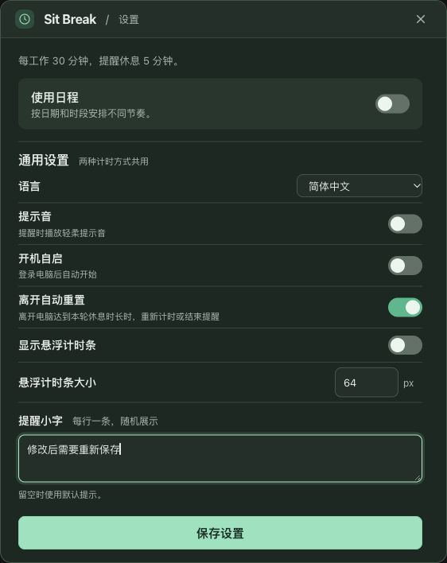

# 日程验证记录

本记录区分自动化、浏览器展示样例和原生执行证据。已实现的退出恢复与电脑睡眠规则见 [日程与休息安排](schedules.md)，相关决策见 [ADR 0003](adr/0003-restore-round-progress.md)。

## 自动化与构建

集成版本 `1c1d4e2666c19f5eb3640d1e64438ef4d8940dbb` 的 115 项 Rust 库测试全部通过，覆盖简单计时、轮次与边界、每周重复及冲突、单轮调整、运行中编辑、离开检测、真实文件保存与重新加载、可控睡眠输入，以及只读草稿预览。日程规则测试从 `TimerApp` 的公开操作观察状态和输出，不依赖真实经过时间来等待。

该版本的 [两平台 CI](https://github.com/yuexiaoliang/sit-break/actions/runs/38551515134) 已通过，`macos-latest` 和 `windows-latest` 均执行了 `npm ci`、`npm run build`、`cargo check --locked`、`cargo clippy --locked --all-targets -- -D warnings`、`cargo fmt --all -- --check`、`cargo test --locked --lib`。CI 构建和测试通过不表示原生窗口或物理睡眠已验收。

最终审查修复另增加 1 项启动回归，使用 Tauri `MockRuntime` 和隔离的测试插件，在插件初始化时提交两次打开请求，再创建面板并交付请求，最后再次打开。它验证窗口未就绪时请求保留、就绪后打开入口可用；不启动真实单实例插件或用户应用，也不证明真实窗口的显示和焦点。正常睡眠样例同时通过现有设置校验，星期统一使用 ISO 的周一 `1` 至周日 `7`。

日程主体与启动修复版本 `6ff2a125ab2aa72dfbf9c1d3e801394c8ba5472b` 的 [两平台 CI](https://github.com/yuexiaoliang/sit-break/actions/runs/38558671883) 已通过。macOS 和 Windows 均实际执行 `npm ci`、`npm run build`、`cargo check --locked`、`cargo clippy --locked --all-targets -- -D warnings`、`cargo fmt --all -- --check`、`cargo test --locked --lib`，各有 116 项通过，0 失败、0 忽略；启动回归在两平台均执行并通过。两平台还实际执行并通过 `cargo build --locked --bin sit-break`，验证普通应用二进制能够链接。本机也完成上述构建与 Rust 检查，以及 `git diff --check`。

加入 MockRuntime 后，Windows 曾在进入测试框架前退出 `0xc0000139`。实际加载探针确认测试程序导入 `comctl32.dll` 的 `TaskDialogIndirect` 等 API，却没有资源段或 manifest。按 [Tauri 维护者的方案](https://github.com/tauri-apps/tauri/issues/13419)，MSVC 目标现在显式向全部链接目标嵌入与当前 Tauri 默认内容相同的 Common Controls v6 manifest，覆盖库测试。没有删除或平台跳过测试；临时诊断步骤已移除。修复后的原测试及普通应用构建通过以上最终 CI。

## 原生执行证据

macOS 独立电源探针直接编译产品的 `power.rs`，实际注册并注销 NSWorkspace 的睡眠和唤醒观察器，初始化含睡眠的连续时钟，并读取真实 CoreGraphics 离开计数；执行退出码为 0。探针没有触发系统睡眠，因此仅证明注册、注销和 API 可用。

Windows 的同一电源模块通过 `x86_64-pc-windows-msvc` 交叉类型检查，完整项目也通过上述 Windows CI。尚未在 Windows 原生应用中实机验收电源通知、窗口或退出重开。

修复后的 macOS 原生验收使用源版本 `835f0bc`、独立标识 `com.sitbreak.acceptance` 和原始可执行文件名。前端实际嵌入应用，使用真实 IPC、设置和进度文件；未使用浏览器展示适配，用户原应用及数据保持不变。

为缩短真实等待，验收使用 2026-10-14 的一次日程，执行时段 18:00–22:00，工作 1 分钟、休息 2 分钟，简单计时为 1/5 分钟，关闭离开自动重置。首轮活动为两行原文。以下结果来自实际窗口及持久化数据：

- 首次启动后立即再次打开同一独立应用，第二实例正常退出且没有 `PanelState` panic，实际面板按钮可操作。
- 暂停并重置后，仍为已暂停的第 1 轮、剩余 60 秒，显示本轮 1/2 分钟。
- 设置开启或关闭日程、保存、打开或关闭预览，窗口均保持 562×785、水平位置 679；保存后的实际配置保留日程开关和身份。
- 原生预览显示当前已生效的第 1 轮、暂停状态和多行内容，关闭按钮与 Esc 均可关闭。焦点返回的直接证据来自浏览器 DOM 检查，没有将原生 AX 读值当作焦点证据。
- 暂停工作后正常退出再打开，恢复 Work、第 1 轮、60 秒及 `paused=true`，关闭期间没有累计倒计时。
- 实际等待工作完成后显示第 1 轮提醒、多行原文和 2 分钟休息；再等等返回同轮工作，轮次和内容保留。
- 开始休息采用本轮完整的 120 秒，走过一秒后窗口显示 1:59，没有采用全局的 5 分钟。
- 休息中暂停至剩余 104 秒后正常退出再打开，持久化的 `info` 全字段与退出前相同；原生窗口显示已暂停的第 1 轮、1:44 和多行原文。
- 提前结束该休息后进入第 2 轮 Work、60 秒，手动暂停仍保留。独立验收应用随后正常退出。

以下是短时独立验收示例，不代表 50/10 分钟日程已经实际等待完成。

## 浏览器展示检查

生产前端在仓库外设置和状态样例适配下检查，适配提供固定数据及模拟 IPC。已验证 320×568 英文深色界面没有横向溢出；切换主题保留中文多行内容和展开状态；预览在浅色与深色下保持设置页宽度，关闭按钮、Esc 和外侧点击返回入口焦点，Tab 循环及方向键滚动可用；模拟 tick 后未保存草稿、原输入节点、展开状态和滚动位置保留。页面与控制台错误列表为空。

预览空档模板修复后，同一生产渲染模块的双语展示检查已通过：中文为「12:00–13:30 不提醒」，英文为「12:00–13:30 · No reminders」，预览正文不含 `{start}` 或 `{end}`。562×785 和 320×568 下，空档行与下午时段标题均没有横向溢出。

展示样例的保存只写展示数据，预览输出来自适配；上述检查不证明 Rust 预计时间、真实 IPC、本地持久化、原生窗口焦点或电源通知。实际命令与持久化的 macOS 证据单独列在上一节。

## 保存反馈回归（2026-10-15）

CUA 浏览器验收曾发现：保存成功后继续修改设置，旧的“已保存 ✓”仍然显示。现在文字、数值、日期和选项编辑，以及自定义开关、快捷时长、星期选择、日程和时段等增删操作都会清除过期成功提示；查看预览、展开单轮内容等只读操作保持提示。

使用生产前端构建和独立展示适配完成 18 项 CUA 回归检查，覆盖原始复现、重新保存、预览与折叠、开关与快捷选择、添加及移除时段、日期与语言选项。注入保存失败响应后，错误提示仍保留；重试成功恢复成功提示，再次编辑也会正确清除。浏览器 error 日志为空，`npm run build` 的 TypeScript 检查与 Vite 构建通过。

这里验证前端反馈与命令接线，保存失败响应由样例适配注入，未将其当作 Rust 或原生持久化验收；此前原生窗口和物理睡眠的验收范围没有扩大。

## 发版验收（2026-10-15）

用户在获取 macOS 独立测试版和 Windows x64 测试包后反馈“我测完了，发版吧”，同意正式发布。本次发布版本为 v0.4.0。此处记录用户验收结论；用户未提供逐项用例结果，不据此扩大上述可复现的代理验收范围。

## 代理记录未覆盖的实机项目

- macOS 原生窗口拖动，以及原生预览关闭后的焦点返回。
- Windows 原生 GUI：简单与日程切换的窗口宽度、提醒操作、预览 Esc 与拖动、正常退出及重新打开。
- macOS 和 Windows 的物理睡眠与唤醒：工作、提醒、已开始休息、暂停及跨时段情形，确认注册通知确实到达应用且只结算一次。

上述代理验收记录未覆盖 Windows GUI 与两平台物理睡眠。用户实机验收结论见上一节；可控输入测试、API 注册探针和双平台 CI 不替代逐项实机证据。
