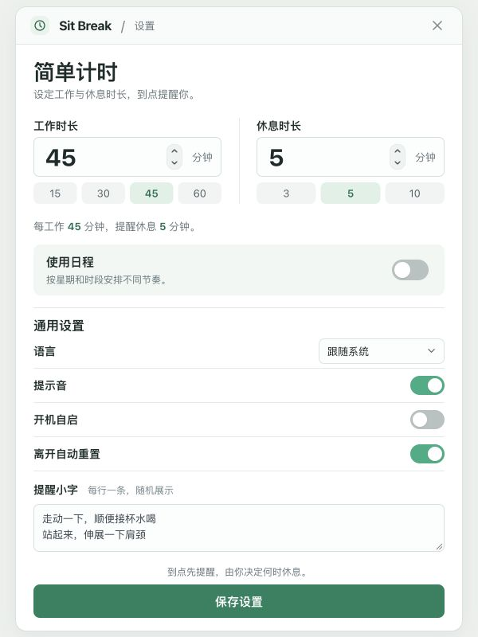
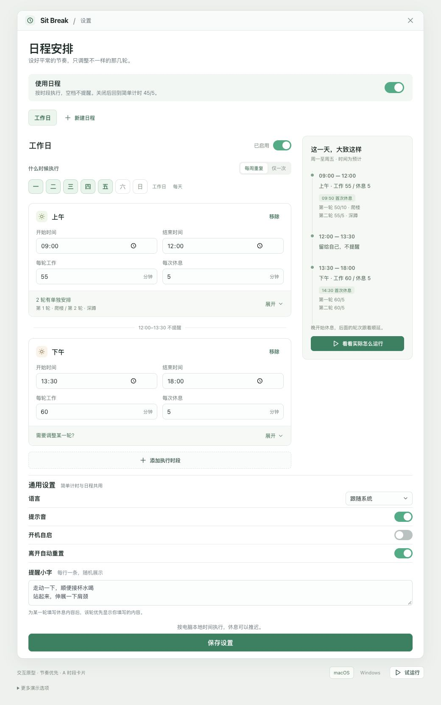

# UI 设计：节奏优先

2026-10-14，用户选定 Product Design 本轮展示的**第 2 张图「节奏优先」**。日程的信息结构继续采用此前已确认的 **A · 时段卡片**。这两个选择分别确定视觉方向与交互结构。

[打开默认简单计时](http://127.0.0.1:1421/settings.html?prototype=schedule&variant=A) · [打开日程安排](http://127.0.0.1:1421/settings.html?prototype=schedule&variant=A&mode=schedule) · [功能规格 #1](https://github.com/yuexiaoliang/sit-break/issues/1) · [设计检查](../../design-qa.md)

## 设计依据

视觉基准为 [用户选择的原始图](selected-reference.png)，原始尺寸 1086 × 1448。原型以 600 × 800 CSS 像素进行等比例对照，简单设置窗口约 562 × 785。

默认打开后直接调整工作、休息时长。需要按星期、时段和轮次安排时，再开启「使用日程」。两种配置分别保留；语言、提示音、开机自启、离开自动重置和提醒小字共用。

## 页面结构

| 区域 | 设计与操作 |
| --- | --- |
| 窗口顶部 | Sit Break、当前页面与关闭入口。原型中关闭会收起设置，可重新打开；正式应用沿用原生关闭行为。 |
| 简单计时 | 工作与休息并排显示，大号数字可直接编辑；保留 15/30/45/60 和 3/5/10 快捷值。 |
| 日程入口 | 浅绿色区块内只放一段说明和一个开关；默认关闭。 |
| 日程管理 | 日程名称与启用状态、每周重复或仅一次、执行日期，以及工作日/每天快捷选项。 |
| 执行时段 | 卡片内先设开始/结束时间与默认工作/休息时长。单轮安排默认收起，有修改时显示轮次和活动摘要。 |
| 单轮安排 | 工作、休息时长及自由文本。可输入一项或多项活动，整次休息共用一个倒计时。 |
| 当天概览 | 展示执行时段、空档和首次预计休息时间；明确时间可能顺延。宽窗口右侧展示，窄窗口放在编辑区之后。 |
| 通用设置 | 纵向排列，控件靠右；提醒小字使用多行输入。Windows 增加悬浮计时条开关与大小。 |
| 保存 | 页面末尾一个全宽主按钮；保存成功显示「已保存」。输入有误时保留草稿，提示问题且不覆盖已保存安排。 |

单轮展开后的样式见 [完整截图](evidence/schedule-expanded.png)。

## 视觉约定

| 项目 | 取值 |
| --- | --- |
| 主要文字 | `#1c2c29` |
| 次要文字 | `#66757a`；在白底上对比度约 4.78:1 |
| 浅色背景 | 页面 `#edf1ee`，内容白色，日程入口 `#f1f7f4` |
| 开启状态 | `#25ad82` |
| 主按钮 | `#18825f`，悬停 `#116c4e`；白字对比度约 4.78:1 |
| 选中项 | 浅绿底配深绿字，不仅靠颜色，还保留按钮/开关选中语义 |
| 字体 | 系统无衬线：macOS 使用系统字体及 PingFang SC；Windows 使用 Segoe UI、Microsoft YaHei。无需下载字体。 |
| 字号 | 主标题 27，简单时长 30，区块标题 16，字段标签 14，正文 13，辅助说明 11–12 CSS px |
| 圆角 | 窗口 14，时段卡片 11，表单及按钮 7–8 CSS px |
| 布局 | 简单窗口最大 562；日程窗口最大 960；日程主栏加 260 宽概览；760 以下转为单栏 |
| 焦点 | 2 px 深绿色外描边；输入框保留焦点环，输入时不重建控件 |
| 动效 | 开关位移及背景过渡约 150 ms；尊重系统减少动态效果设置 |

主按钮比原图更深，是为提高白色按钮文字的可读性；保留原图的绿色方向与主次关系。原图的轻微纹理与渐变作为图像生成效果处理，实际表单使用干净纯色。

### 资源清单

原图没有照片、插画、头像或需要拆出的位图。标题前为通用时钟标识；标准图标使用 [Tabler Icons](https://github.com/tabler/tabler-icons) 的 MIT 授权轮廓图标，来源锁定于 `@tabler/icons@3.49.0`，通过官方 SVG 文件导入。没有手绘 SVG、字符或表情代替图标，也没有另行生成品牌标识。原始选中设计图保留在本目录。

系统字体属于已有运行平台的字体回退，不随仓库重新分发。生成图无法提供精确字体元数据，采用系统字体匹配其字形风格、层级和密度。

## 状态设计

| 状态 | 画面及反馈 | 验证依据 |
| --- | --- | --- |
| 工作中 | 浅绿面板、剩余时间、当前时段与轮次 | 试运行当前轮次 |
| 休息提醒 | 活动文本优先，保留「再等等」与「开始休息」；点击开始后才计时 | [提醒截图](evidence/reminder.png) |
| 休息中 | 深绿面板、完整倒计时、自由活动文本；可提前结束 | [休息截图](evidence/break.png) |
| 暂停 | 浅暖色面板、明确的「已暂停」与进度保留说明 | [暂停截图](evidence/paused-final.png) |
| 待机 | 「现在不提醒」与下一有效时段；没有安排时保持安静 | [午休待机截图](evidence/idle.png) |
| 空日程 | 说明没有执行时段，并提供「添加执行时段」 | [空日程截图](evidence/empty-schedule.png) |
| 保存错误 | 浅红提示，点明冲突日程及时段；草稿继续可改 | [冲突截图](evidence/conflict.png) |
| 保存成功 | 主按钮变为「已保存」，短暂状态反馈 | 浏览器实测 |

不同运行状态是给后续实现的视觉与行为依据，页面中的演示时钟、情景按钮和系统预览仍属于原型工具。

## 响应式与原有功能

已检查 600 × 800 的设计基准、1040 × 1000 的日程布局，以及 375 和 320 CSS 像素宽度。窄窗口保留并排时长和快捷值，隐藏额外数字步进按钮，但可直接输入和用键盘调整；日程改为单栏，内容纵向滚动。保存入口始终可通过正常滚动访问。

[Windows 375 px](evidence/windows-375.png) · [Windows 320 px](evidence/windows-320.png) · [日程 375 px](evidence/schedule-375.png)

macOS 的试运行展示菜单栏状态；Windows 保留悬浮计时条开关、大小和预览。平台切换、试运行、早期 A/B/C 比较和数据查看均放在产品窗口之外；「更多演示选项」默认收起。

## 交付范围

这是 `codex/prototype-round-schedules` 上的前端设计原型，刷新会恢复示例；实际提醒、持久化、系统空闲、休眠恢复和原生窗口仍按 [规格 #1](https://github.com/yuexiaoliang/sit-break/issues/1) 后续实现。声音、自启和语言控件只演示状态，不修改系统设置或切换整页语言。本次没有修改 Rust 计时引擎或正式 Tauri 窗口尺寸。

界面已明确，正式接入时需要将窗口大小与屏幕可用区域适配，并验证 macOS、Windows 的真实窗口、原生时间输入与字体显示。原型的模拟日期固定为 2026-10-14（周三）；示例下午结束时间为 18:00。
