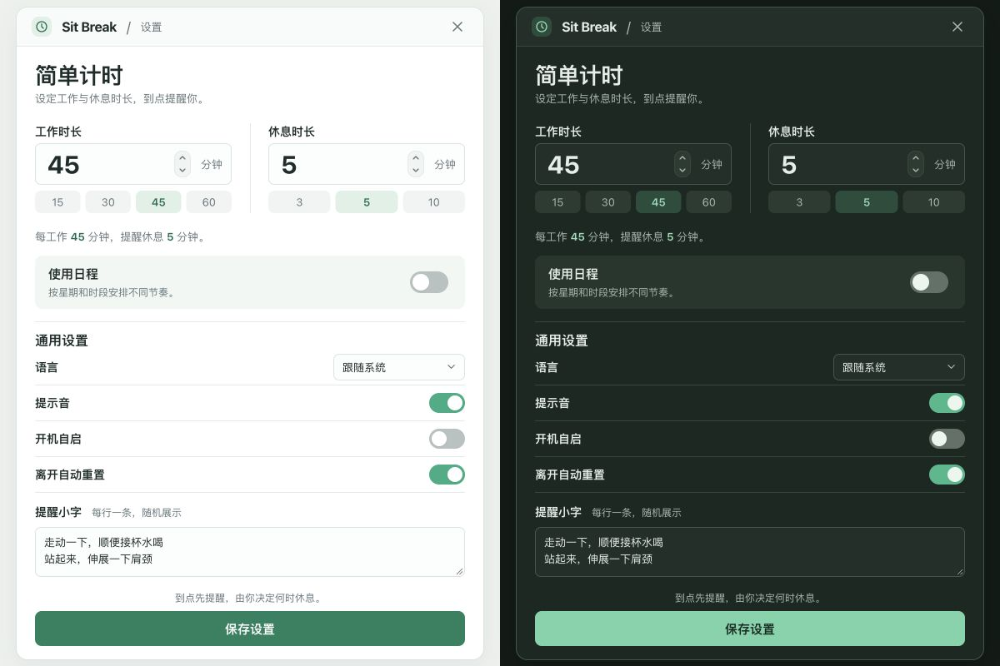

# UI 设计：节奏优先

用户选择的第 2 张图「节奏优先」确定视觉方向，A · 时段卡片确定日程交互结构。2026-10-14 的补充要求已应用：支持深色模式，只保留 A，开启和关闭日程时窗口宽度不变。

[默认预览](http://127.0.0.1:1421/settings.html?prototype=schedule) · [深色预览](http://127.0.0.1:1421/settings.html?prototype=schedule&theme=dark) · [日程安排](http://127.0.0.1:1421/settings.html?prototype=schedule&mode=schedule) · [功能规格 #1](https://github.com/yuexiaoliang/sit-break/issues/1) · [设计检查](../../design-qa.md)

## 设计依据

[选中的原始设计图](selected-reference.png)为 1086 × 1448，按比例映射至 600 × 800 CSS px。简单设置窗口为 562 × 785；浅色布局与其对照，深色延续相同字体、间距和控件层级。

默认直接调整工作、休息时长。需要按星期、时段和轮次安排时，再开启「使用日程」。两种配置分别保留；通用设置共用。

## 页面结构

| 区域 | 设计与操作 |
| --- | --- |
| 窗口顶部 | Sit Break、当前页面与关闭入口；原型可收起后重新打开。 |
| 简单计时 | 工作与休息并排显示，大号数字可编辑，保留工作 15/30/45/60、休息 3/5/10 快捷值。 |
| 日程入口 | 一段说明和一个开关，默认关闭。 |
| 日程管理 | 名称、启用状态、每周重复或仅一次；提供工作日/每天快捷选择。 |
| 执行时段 | 先设置时间范围和默认时长，单轮安排按需展开。 |
| 单轮安排 | 工作、休息时长和自由文本；一项或多项活动均共用一次倒计时。 |
| 当天概览 | 位于时段列表之后，展示时段、空档、预计首次休息并提示时间可能顺延。 |
| 通用设置 | 语言、提示音、自启、离开自动重置及提醒小字；Windows 增加悬浮计时条和大小。 |
| 保存 | 底部全宽主按钮；成功显示「已保存」，有误时保留草稿并提示冲突。 |

所有页面统一使用最大 **562 CSS px** 窗口。切换日程只改变内容与高度，保持宽度和水平位置不变。日程、概览和试运行使用单栏，窄屏时随可用空间缩小。

[浅色日程截图](evidence/schedule-light.png) · [深色日程截图](evidence/schedule-dark.png)

## 主题约定

默认跟随系统，系统外观变化时实时更新。原型窗口外提供「跟随系统 / 浅色 / 深色」预览选择器；切换时保留草稿、展开状态和试运行进度。产品设置中不增加额外步骤。

| 语义 | 浅色 | 深色 |
| --- | --- | --- |
| 页面背景 | `#edf1ee` | `#111b17` |
| 窗口内容 | `#ffffff` | `#1b2822` |
| 输入框 | `#fcfdfd` | `#202f28` |
| 主要文字 | `#1c2c29` | `#e5eee9` |
| 次要文字 | `#66757a` | `#a6b9b2` |
| 分组背景 | `#f1f7f4` | `#24372d` |
| 边框 | `#dce3e3` | `#41564b` |
| 主按钮背景 / 文字 | `#18825f` / 白色 | `#71d4a9` / `#102b20` |
| 开启状态 | `#25ad82` | `#35ba8b` |
| 选中项 | 浅绿底深绿字 | 深绿底浅绿字 |
| 焦点描边 | `#16684f` | `#a0eac5` |

浅色主按钮白字对比度约 4.78:1；深色按钮约 8.42:1；深色次要文字在窗口底色上约 7.43:1。按语义设置各状态颜色，保留边界、标签和选中状态，不以整页颜色反转实现深色外观。原生表单控件使用对应的 `color-scheme`。

字体为系统无衬线：macOS 使用系统字体及 PingFang SC，Windows 使用 Segoe UI、Microsoft YaHei。标题 27、简单时长 30、区块标题 16、字段标签 14、正文 13、辅助说明 11–12 CSS px。窗口圆角 14，时段卡片 11，表单与按钮 7–8。开关过渡约 150 ms，尊重系统减少动态效果设置。

标准图标来自 [Tabler Icons](https://github.com/tabler/tabler-icons)，MIT 授权，依赖锁定为 `@tabler/icons@3.49.0`。无需下载字体或生成额外图片资源。浅色主按钮有意比原始图更深，以提高文字可读性。

## 运行状态

| 状态 | 视觉与行为 | 深色证据 |
| --- | --- | --- |
| 工作中 | 绿色面板、剩余时间、当前时段与轮次 | 浏览器操作检查 |
| 休息提醒 | 活动内容优先，保留「再等等」和「开始休息」 | [提醒](evidence/reminder-dark.png) |
| 休息中 | 更深的绿色面板、完整倒计时与活动内容 | [休息](evidence/break-dark.png) |
| 暂停 | 暖色面板及「已暂停」，进度保留 | [暂停](evidence/paused-dark.png) |
| 待机 | 中性面板、「现在不提醒」及下一有效时段 | [待机](evidence/idle-dark.png) |
| 空日程 | 说明没有执行时段，并提供添加入口 | [空日程](evidence/empty-dark.png) |
| 保存错误 | 红色提示说明冲突，草稿继续可改 | [冲突](evidence/conflict-dark.png) |
| 保存成功 | 主按钮显示「已保存」，短暂状态反馈 | 浏览器操作检查 |

## 响应式与原有功能

已在明暗两种主题下检查 1280、600、375 和 320 CSS px 视口。打开与关闭日程前后，窗口宽度和水平位置完全相同，均无横向溢出；宽度实测见 [设计检查](../../design-qa.md)。窄窗口保留并排时长和快捷值，可直接输入，内容纵向滚动。

[320 px 深色日程](evidence/schedule-dark-320.png) · [320 px Windows 设置](evidence/windows-dark-320.png)

外观、平台和试运行是窗口外的预览工具。其他方案、布局切换快捷键、调试数据面板及过期截图已清理；旧版本可从 Git 提交历史查阅。

## 交付范围

这是 `codex/prototype-round-schedules` 上的前端设计原型，刷新恢复示例。真实提醒、持久化、系统空闲、休眠恢复和原生窗口按规格后续实现。声音、自启和语言控件只演示状态。本轮没有修改 Rust 计时引擎或正式 Tauri 窗口配置。

正式接入时应保持相同的窗口宽度规则，并在 macOS、Windows 实机验证系统主题变化、时间输入控件和字体度量。模拟日期固定为 2026-10-14（周三），下午结束时间 18:00 为示例值。
